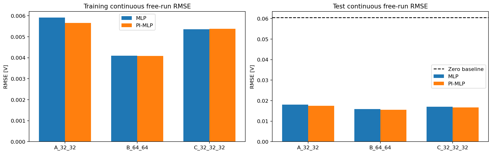
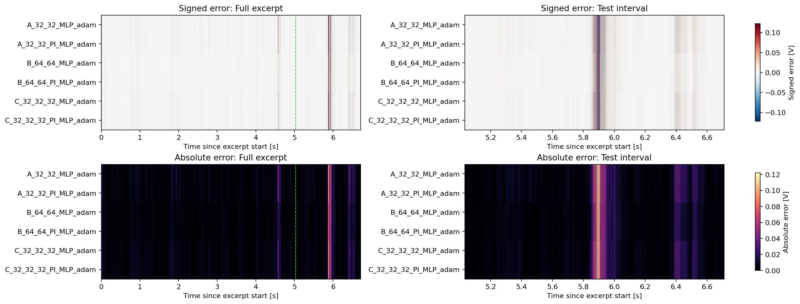

# duffing-neural-ode

**Learn nonlinear circuit dynamics from voltage recordings with neural ODEs and Duffing physics.**

This project compares three acceleration MLPs with three physics-informed versions on a
Silverbox recording. Each network predicts acceleration from the current output voltage,
its rate of change, and the applied input voltage. A differentiable RK4 integrator turns
those predictions into a continuous simulated trajectory.

The best model in the recorded experiment is the **64 × 64 physics-informed MLP**, with
**15.569 mV test free-run RMSE**. The matching ordinary MLP reaches 15.886 mV.



## Explore the project

| File | Purpose |
|---|---|
| [DuffingNeuralOde.ipynb](DuffingNeuralOde.ipynb) | Completed Kaggle run, including printed progress, tables, and plots |
| [Duffing_PINN_Kaggle.ipynb](Duffing_PINN_Kaggle.ipynb) | Clean, unexecuted notebook for running the experiment |
| [Recorded results](results/20261011T060628Z_5a34e14b/) | Six final checkpoints, histories, predictions, figures, and run settings |
| [Comparison table](results/20261011T060628Z_5a34e14b/comparison.csv) | Training/test RMSE, parameter counts, timing, and fitted coefficients |
| [Errors at every timestamp](results/20261011T060628Z_5a34e14b/all_models_residuals.csv) | Measured/predicted voltage and signed, absolute, squared, and local RMSE errors |
| [silverbox-explanation.png](silverbox-explanation.png) | An AI-generated illustration of the spring–damper analogy |

The executed and clean notebooks contain the same code. The original development copy,
temporary editing scripts, duplicate checkpoints, and raw ZIP archives are excluded from Git.

## Model and experiment

Silverbox is an electronic implementation of a Duffing-like nonlinear oscillator. Here,
“position” is an analogy for **output voltage**, not a measured mechanical displacement.

```text
current simulated voltage y ─┐
current simulated rate v ────┼─> fixed scaling -> MLP -> acceleration -> RK4 -> next y, v
known input voltage u ───────┘                                           │
                           <──────── simulated state feeds back ────────┘
```

The learned dynamics are

$$\dot y=v,\qquad \dot v=f_\theta(y,v,u).$$

All networks have three inputs, tanh hidden layers, and an unrestricted linear acceleration
output. Their hidden widths are `(32, 32)`, `(64, 64)`, and `(32, 32, 32)`. Scaling constants
are estimated from training data and stored in model buffers; integration remains in physical units.

The physics-informed variants add a normalized residual penalty for

$$\ddot y=gu-av-by-cy^3.$$

They jointly learn the network weights and four unknown coefficients. The loss is

$$L=\mathrm{RMSE}(\hat y,y)/s_y+0.1\,\mathrm{mean}\left[
\left(\frac{f_\theta(y,v,u)-(gu-av-by-cy^3)}{s_\alpha}\right)^2\right].$$

These are **physics-informed dynamics MLPs (PI-MLPs)**, not classical time-input PINNs
that represent `y(t)` and differentiate it with respect to time. Both families predict
acceleration and use the same RK4 solver during evaluation. RK4 by itself does not impose
the Duffing equation on an ordinary MLP.

### Data and scoring

- File: `SNLS80mV.csv`, input `V1`, output `V2`.
- Sampling frequency: 610.35 Hz.
- Excerpt: Python rows `[42650:46746]`, giving 4096 samples.
- Split: first 3072 samples for training, final 1024 for testing.
- Centering: subtract means over the full excerpt, as specified by the coursework protocol.
- Training: 900 Adam updates per model, batches of 32 sections; 300 updates each at
  32, 64, and 128 RK4 steps, with learning rates `1e-3`, `3e-4`, and `1e-4`.
- Initialization: first training voltage and a forward-difference estimate of its rate.
- Evaluation: **one continuous free run over all 4096 samples**, without a reset at the
  train/test boundary. Test voltage is used only for scoring, not fed into the simulation.

This is a **coursework excerpt experiment**, not the official full Silverbox benchmark
evaluation. Its numbers should not be compared directly with leaderboard scores.
The coursework selects the best trial by test RMSE; that score is therefore not an
untouched estimate after model selection.

## Recorded results

Run: `20261011T060628Z_5a34e14b`. All six models completed 900 updates.

| Hidden layers | MLP test RMSE | PI-MLP test RMSE | Relative reduction |
|---|---:|---:|---:|
| 32 × 32 | 18.050 mV | 17.562 mV | 2.70% |
| 64 × 64 | 15.886 mV | **15.569 mV** | 2.00% |
| 32 × 32 × 32 | 17.012 mV | 16.760 mV | 1.48% |

The zero-output test baseline is **60.492 mV**. Physics regularization improves each
paired model slightly in this run. The experiment uses one seed (`42`) and one physics
weight (`0.1`), so it does not establish a general advantage across seeds or settings.

The largest shared error burst occurs around **5.9 seconds**. The best model still has a
peak test absolute error of approximately **112.7 mV** there. This localized failure is a
useful next target for analysis; a low average RMSE does not mean every interval is accurate.



Signed residual is `predicted - measured` in volts. The maps share color limits across
models. The results folder also contains full-record/test overlays and residual plots
for **every** model, learning histories, and trailing 64-sample RMSE plots.

## Run locally

1. Obtain the CSV from the [official Silverbox dataset page](https://sites.google.com/view/nonlinear-benchmark/benchmarks/silverbox).
   Extract `SNLS80mV.csv` into `SilverboxFiles/` beside the notebooks, or set `DATA_PATH`
   inside the notebook. The full source dataset is not redistributed in this repository.
2. Create a Python environment and install the dependencies:

   ```bash
   python -m venv .venv
   # Windows PowerShell: .venv\Scripts\Activate.ps1
   # macOS/Linux: source .venv/bin/activate
   python -m pip install -r requirements.txt
   python -m jupyterlab
   ```

3. Open `Duffing_PINN_Kaggle.ipynb` from the repository root. Run the cells in order.
   The cell marked **TRAINING STARTS HERE** trains all six trials.

CUDA is selected when available; `device_choice="cpu"` forces CPU. The notebook uses
one GPU. The recorded run used Python 3.13.15, PyTorch 2.11.0+cu128, NumPy 2.1.3,
pandas 2.3.3, and a Tesla T4. See `run_metadata.json` for the recorded environment.
Dependency ranges in `requirements.txt` are not an exact environment lock.

## Run on Kaggle

1. Import the clean notebook.
2. Attach a dataset containing `SNLS80mV.csv`; optionally include `silverbox-explanation.png`.
3. Choose an accelerator if desired.
4. Use **Save Version → Save & Run All** for a saved run. Follow progress in **Logs**.
   This is a separate job from the interactive editor; do not launch a duplicate training run there.
5. After completion, download the `silverbox_<run-id>.zip` from the saved version's **Output** tab.

For an interactive run, download the ZIP while the session is alive. A downloaded
`.ipynb` contains code and displayed outputs, **not the checkpoint files**. Files written
to a discarded session are not a durable backup. See [Kaggle's notebook documentation](https://www.kaggle.com/docs/notebooks).

## Use the saved models without retraining

The six `*_final.pt` files include model weights, optimizer state, fixed scales,
preprocessing settings, update count, history, and RNG states. All are small enough to
be tracked directly in Git. SHA-256 checksums are in `checkpoint_inventory.csv`.

To regenerate the results locally, run the clean notebook's setup cells and set:

```python
RESUME_RUN_DIR = "results/20261011T060628Z_5a34e14b"
```

Then execute the training cell and subsequent evaluation/plotting cells. It will load
and **skip all six completed trials**, writing a new local output folder. Keep the supplied
data and experiment settings unchanged; the resume code checks them against the saved run.
The raw CSV is still needed for this route. An incomplete run would resume unfinished trials.

For one model, after executing its class/helper definitions, use:

```python
model, checkpoint = restore_trial_for_prediction(
    "results/20261011T060628Z_5a34e14b/B_64_64_PI_MLP_adam_final.pt",
    device="cpu",
)
```

Use `checkpoint["preprocessing"]` for that model's centering, scales, sampling interval,
and initial state. This helper reconstructs the saved model without training.

New runs save a checkpoint before training, every 50 updates, at stage boundaries,
and at completion. Writes include read-back verification and retain a previous copy.
The ZIP refreshes as checkpoints are saved. Repository results retain the six final
checkpoints; redundant `latest`/`previous` files remain in the original local archive.

## Limitations and next experiments

- Finite-difference rate estimates can amplify noise and affect initialization.
- Training sections contain at most 128 steps, while evaluation spans 4095 steps.
- Positive damping and stiffness are modeling assumptions; fitted coefficients are not
  independently verified circuit constants.
- The physics weight, optimizer schedule, and rollout lengths are initial settings.
- Seeds and saved RNG state help reproducibility; device/library differences can change results.

Useful next steps are to inspect the 5.9-second interval, evaluate several seeds, and
compare longer rollouts and physics weights using a training-only validation split.

## Data credit and references

The Silverbox data are credited to T. Wigren and J. Schoukens, *Three free data sets for
development and benchmarking in nonlinear system identification*, European Control
Conference, 2013, pp. 2933–2938. [DOI: 10.23919/ECC.2013.6669201](https://doi.org/10.23919/ECC.2013.6669201).
The small measured excerpt also appears in the executed notebook and prediction CSVs.

- [Silverbox benchmark and data](https://sites.google.com/view/nonlinear-benchmark/benchmarks/silverbox)
- [Physics-informed learning](https://maziarraissi.github.io/PINNs/)
- [PyTorch checkpoint saving and loading](https://docs.pytorch.org/tutorials/beginner/saving_loading_models.html)
